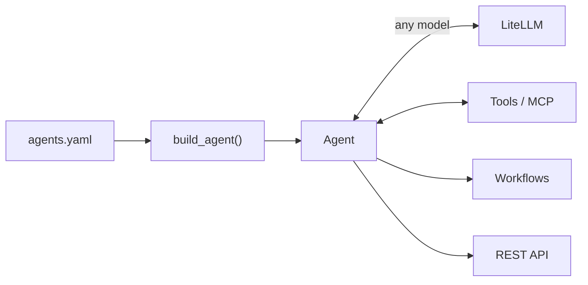

# miniAgent

A small, typed Python SDK for building AI agents and multi-agent workflows,
with any model through [LiteLLM](https://docs.litellm.ai/).

[](https://python.org)
[](LICENSE)

- **Any model, one string:** `"openai/gpt-4o"`, `"anthropic/claude-sonnet-4-6"`, `"gemini/gemini-2.0-flash"`, local models.
- **Agents in YAML:** validated profiles with tools, MCP servers and memory settings.
- **Batteries included, nothing wrapped:** its own agent loop, tools, workflows and REST API, without other agent frameworks or vendor SDKs.

## Features

| Area | What's included | Guide |
|------|-----------------|-------|
| **Models** | Every LiteLLM provider · per-agent settings · Claude extended thinking · token counting | [Configuration](docs/guides/configuration.md) |
| **Agents** | ReAct loop · token streaming (`agent.stream()`) · structured output (validated Pydantic answers) · YAML profiles · 9 persona templates · `build_agent()` | [Agents](docs/guides/agents.md) |
| **Tools** | 10 built-ins · `@tool` decorator · argument validation · parallel calls · timeouts · errors sent back to the model | [Tools](docs/guides/tools.md) |
| **MCP** | stdio and HTTP servers · declared in YAML with `${VAR}` secrets · filter and prefix tools | [Tools → MCP](docs/guides/tools.md#mcp-servers) |
| **Memory** | Context window trimming (`max_context_tokens`) · sessions in memory or SQLite | [Memory](docs/guides/memory.md) |
| **Workflows** | Sequential · parallel · loop · graph with conditional routing | [Workflows](docs/guides/workflows.md) |
| **Serving** | FastAPI REST API · session-aware runs · streamed agent replies and workflow progress over SSE · typed errors | [REST API](docs/guides/rest-api.md) |

**Bring your own** by subclassing: `BaseLLMProvider` (model gateway),
`BaseAgent` (agent logic), `BaseTool` / `BaseToolset` (tools),
`ContextPolicy` / `SessionStore` (memory), `BaseWorkflow` (orchestration).

**Left out on purpose** to stay mini:
- **RAG and long-term memory:** expose them as a tool or MCP server.
- **Checkpoint/resume and human-approval pauses.**
- **Retries and tracing:** available through LiteLLM settings (`extra_params`) and callbacks.

## Install

miniAgent is not on PyPI yet; install it from a clone of this repository:

```bash
pip install -e .                   # core
pip install -e ".[mcp]"            # + MCP servers
```

Requires Python 3.10+. Set your provider's key, e.g. `export OPENAI_API_KEY=...`.

## Quick start



**1. Define an agent** in `agents.yaml`:

```yaml
agents:
  - name: assistant
    system_prompt: "You are a concise, helpful assistant."
    model: {id: "openai/gpt-4o-mini"}
    tools: [calculator, timestamp]
```

**2. Run it from Python:**

```python
import asyncio
from miniagent import AgentProfile, Message, MessageRole, State, build_agent

async def main() -> None:
    agent = build_agent(AgentProfile.from_yaml("agents.yaml", name="assistant"))
    state = State(messages=[Message(role=MessageRole.USER, content="What is 17 * 23?")])
    final_state = await agent.run(state)
    print(final_state.messages[-1].content)

asyncio.run(main())
```

**3. Or serve it over HTTP:**

```bash
python -m miniagent
curl -X POST localhost:8000/agents/assistant/run \
  -H 'Content-Type: application/json' -d '{"message": "What time is it?"}'
```

## Learn more

| Guide | Covers |
|-------|--------|
| [Configuration](docs/guides/configuration.md) | YAML fields, model settings, templates |
| [Agents](docs/guides/agents.md) | The loop, `build_agent`, state, errors |
| [Tools](docs/guides/tools.md) | Built-ins, `@tool`, MCP servers |
| [Memory](docs/guides/memory.md) | Context window, sessions |
| [Workflows](docs/guides/workflows.md) | Sequential, parallel, loop, graph |
| [REST API](docs/guides/rest-api.md) | Endpoints, environment variables |
| [Development](docs/guides/development.md) | Setup, checks, package layout |

Runnable scripts are in [`examples/`](examples/), and a fuller config in
[`agents.example.yaml`](agents.example.yaml).

## License

MIT — see [LICENSE](LICENSE).
