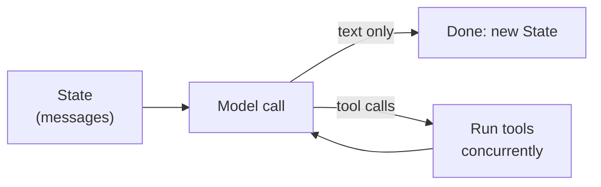

# Agents

An `Agent` runs a ReAct loop: ask the model, run the tools it requests, repeat
until it answers in plain text or hits `max_iterations`.



## Create and run

```python
from miniagent import AgentProfile, Message, MessageRole, State, build_agent

agent = build_agent(AgentProfile.from_yaml("agents.yaml", name="assistant"))

state = State(messages=[Message(role=MessageRole.USER, content="What is 17 * 23?")])
final_state = await agent.run(state)
print(final_state.messages[-1].content)
```

`build_agent(profile, *, tools=None, toolsets=(), llm_provider=None, output_type=None)`:

- **`tools`:** your own tools by name; they add to or replace the built-ins.
- **`toolsets`:** connected tool sources (MCP servers) the profile picks by name.
- **`llm_provider`:** defaults to the shared `LiteLLMProvider`.
- **`output_type`:** a Pydantic model the answer must match (see below).
- **Fails fast** with `ConfigurationError` on an unknown tool or toolset name.

Direct construction gives the same agent:
`Agent(profile, provider, tools, toolsets=[...], context_policy=..., output_type=...)`.

## Streaming

`agent.stream(state)` is the same run as `run()`, delivered as events while the
model writes:

```python
from miniagent.agent import RunCompleted, TextDelta, ToolCallStarted

async for event in agent.stream(state):
    if isinstance(event, TextDelta):
        print(event.text, end="", flush=True)
    elif isinstance(event, ToolCallStarted):
        print(f"\n[calling {event.tool_call.tool_name}]")
    elif isinstance(event, RunCompleted):
        final_state = event.state
```

| Event | When | Holds |
|-------|------|-------|
| `TextDelta` | The model writes text | `text` |
| `ToolCallStarted` | A requested tool is about to run | `tool_call` |
| `ToolCallFinished` | A tool returned | `result` (the `TOOL` message) |
| `RunCompleted` | Always last | `state`, exactly what `run()` returns |

- **Tool calls stream too**, and tools still run concurrently.
- **Any provider works:** LiteLLM streams for real; other providers and custom
  `BaseAgent`s deliver their result in one piece.

## Structured output

Give the agent a Pydantic model, and its final answer comes back as a validated
object instead of free text:

```python
from pydantic import BaseModel, Field
from miniagent.agent import OUTPUT_VARIABLE

class Invoice(BaseModel):
    number: str = Field(description="Invoice number, e.g. 'INV-7'.")
    total: float

agent = build_agent(profile, output_type=Invoice)
final_state = await agent.run(state)
invoice: Invoice = final_state.variables[OUTPUT_VARIABLE]   # key "output"
```

- **The JSON Schema is added to the system prompt**; field descriptions guide the model.
- **Invalid replies are sent back for correction:** the model is told what was
  wrong (`total: Field required`) and answers again, within `max_iterations`.
- **No valid answer in time** raises `AgentExecutionError`.
- **Tools still work** before the final answer; code fences around the JSON are tolerated.
- **Works with any model**, no provider JSON mode needed. For extra reliability
  on models that support it, add `extra_params: {response_format: {type: json_object}}`.
- **Python only:** `output_type` is a Python class, so it is set in code, not YAML.

## State and messages

- **`State`** carries `messages`, `variables`, `step_count` / `max_steps` and
  `status`. Its methods (`add_message`, `set_variable`, `increment_step`) return
  a new `State`.
- **`status`:** a standalone run goes from `PENDING` to `COMPLETED`. Inside a
  workflow, the workflow owns it (`RUNNING`, then `COMPLETED`); a failure
  raises `WorkflowExecutionError`.
- **`Message`** is frozen: `role` (`SYSTEM`, `USER`, `AI`, `TOOL`), `content`,
  `id`, `timestamp`, plus the typed fields below.

| On | Field | Holds |
|----|-------|-------|
| `AI` | `tool_calls` | The tools the model asked to run (`ToolCall`: `id`, `tool_name`, `arguments`) |
| `AI` | `model`, `reasoning`, `thinking_blocks` | Which model replied, and its reasoning when it gave any |
| `TOOL` | `tool_call_id`, `tool_name`, `is_error` | Which request the result answers, and whether the tool failed |
| any | `metadata` | Your own data; miniAgent never reads it |

```python
for message in final_state.messages:
    if message.role == MessageRole.TOOL and message.is_error:
        print(f"{message.tool_name} failed: {message.content}")
```

## Errors

Every runtime error is a `MiniAgentError` (from `miniagent.core`); wiring
mistakes in your own code, such as registering a name twice, raise
`ValueError` or `TypeError`.

| Error | Raised when |
|-------|-------------|
| `ConfigurationError` | YAML invalid, unknown tool/toolset/template |
| `AgentExecutionError` | The model call fails or returns nothing, tool names clash, or the step limit is hit |
| `ToolInvocationError` | A tool rejects its input (reported to the model, not raised) |
| `WorkflowExecutionError` | A workflow is misconfigured, exceeds `max_steps`, or an agent in it fails |
| `LLMProviderError` | LiteLLM fails (network, auth, quota, bad model id) or the reply is unusable; inside an agent run it arrives wrapped in `AgentExecutionError` |
| `SessionStoreError` | Invalid session id or session storage failure |

## Custom agent logic

Subclass `BaseAgent` and implement `async run(state) -> State`. Override
`stream` to report progress. Workflows accept any `BaseAgent`.
