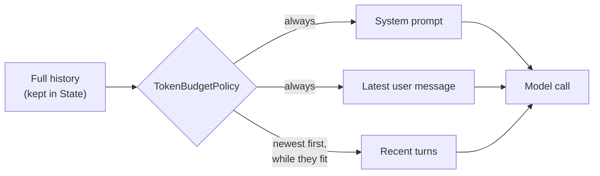

# Memory & Context

Two small features: **trim** what each model call sees, and **remember**
conversations across runs.

## Context window

Each turn and tool result lengthens the history, and a long run eventually
overflows the model. Set a token budget and old turns are dropped from the
request:

```yaml
agents:
  - name: researcher
    model: {id: openai/gpt-4o}
    max_context_tokens: 32000
```



- **Only the request is trimmed.** The returned `State` keeps every message.
- **Oldest turns go first**, and the newest turn is always kept.
- **A tool call and its results stay together**, since models reject one without the other.
- **Re-checked every loop iteration**, so long tool loops stay in budget.
- **Tokens are counted** with LiteLLM's tokenizer for the model (an estimate for other providers).
- **The budget covers messages only.** Leave room for tool definitions and the reply.

In code: `Agent(..., context_policy=TokenBudgetPolicy(max_tokens=32000))`.
For another strategy (e.g. summarizing), subclass `ContextPolicy`.

## Sessions

`agent.run()` remembers nothing between calls. A session store keeps each
conversation under a `session_id`.

**Over the REST API**, send the same id with each message:

```bash
curl -X POST localhost:8000/agents/assistant/run -H 'Content-Type: application/json' \
  -d '{"message": "My name is Ada.", "session_id": "chat-1"}'
curl -X POST localhost:8000/agents/assistant/run -H 'Content-Type: application/json' \
  -d '{"message": "What is my name?", "session_id": "chat-1"}'
```

- **No `session_id`, no memory.**
- **Set `SESSION_DB_PATH`** to a SQLite file to survive restarts; otherwise
  sessions live in memory (up to 1,000, least recently used dropped first).
- **Only the conversation is stored**, not the system prompt, so prompt edits apply at once.
- **A failed run saves nothing**; storage failures return `503`.
- **Session ids are not secrets.** Build them from your authenticated user, e.g. `f"{user_id}:{chat_id}"`.

**In code:**

```python
from miniagent.memory import SQLiteSessionStore   # or InMemorySessionStore()

store = SQLiteSessionStore("sessions.db")
history = await store.load("chat-1")
final_state = await agent.run(State(messages=[*history, Message(role=MessageRole.USER, content="Hi!")]))
await store.append("chat-1", final_state.messages[len(history):])
```

- **Concurrent requests to one session never interleave** their messages.
- **Stores keep the full history**; pair them with `max_context_tokens`.
- **Another backend** (Redis, Postgres): subclass `SessionStore` (`load`, `append`, `delete`).
