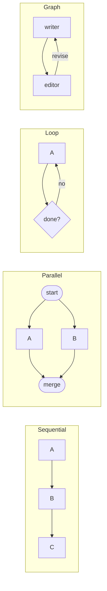

# Workflows

Workflows run several agents over one shared `State`. All four share one
interface:

```python
workflow.register_agent(agent)            # ValueError on a duplicate name
final_state = await workflow.run(state)
```

**Tools belong to each agent**, given via `build_agent(tools=..., toolsets=...)`;
the workflow only decides which agent runs when.



## Sequential

```python
from miniagent.workflow import SequentialWorkflow

workflow = SequentialWorkflow(name="pipeline", agent_order=["researcher", "writer"])
```

Each agent sees every earlier message. Without `agent_order`, registration
order is used.

## Parallel

```python
from miniagent.workflow import ParallelWorkflow

workflow = ParallelWorkflow(name="fan-out")   # every registered agent runs at once
```

- **Every branch starts from the same input state**; none sees another's messages.
- **Messages** from all branches are merged by timestamp.
- **Variables** merge last-write-wins; `step_count` adds each branch's steps.
- **A branch that raises** fails the whole workflow with `WorkflowExecutionError`.

## Loop

```python
from miniagent.workflow import LoopWorkflow

workflow = LoopWorkflow(
    name="refine",
    agent_order=["refiner"],
    exit_condition=lambda state: state.variables.get("score", 0) >= 8,
    max_iterations=5,
)
```

The exit condition is checked after each full pass; without one, the loop runs
`max_iterations` times.

## Graph

```python
from miniagent.workflow import END_NODE, GraphWorkflow

workflow = GraphWorkflow(name="review", entry_point="writer")
workflow.add_edge("writer", "editor")
workflow.add_conditional_edge(
    "editor", lambda state: "writer" if state.variables.get("needs_revision") else END_NODE
)
```

- **A router returns the next node**, `END_NODE`, or `None` to stop.
- **A node without an edge** ends the run.
- **Exceeding `state.max_steps`** raises `WorkflowExecutionError`.

## Serving workflows

Register a workflow by name to run it over the REST API (see
[rest-api.md](rest-api.md)):

```python
from miniagent.api.dependencies import get_workflow_registry

get_workflow_registry().register("pipeline", workflow)
```
